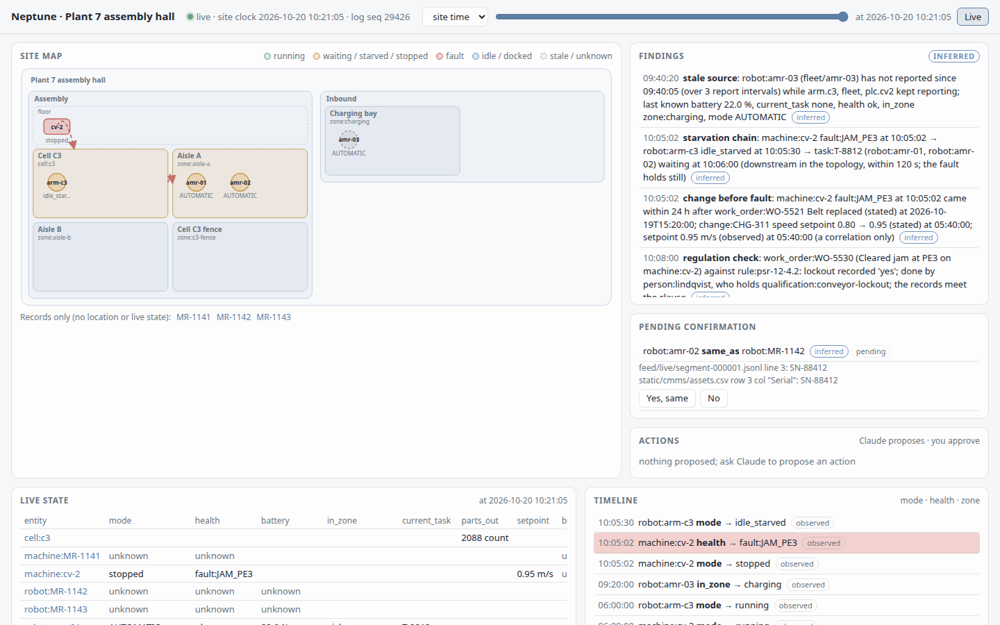
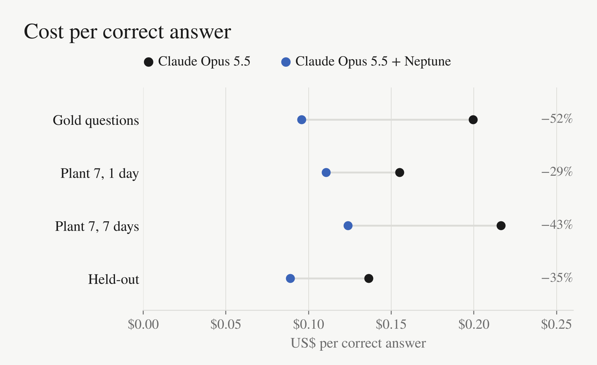
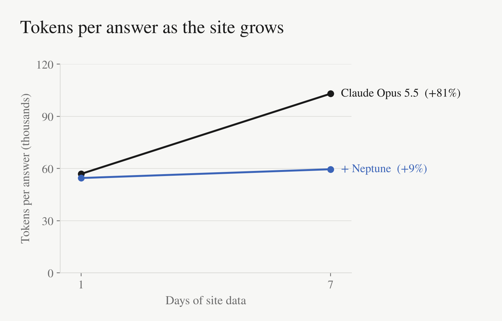

# Neptune

**A live, cited memory of a robot site, for AI agents.**

Point Neptune at the data a site already has (robot logs and feeds, maintenance exports, rosters, manuals,
SOPs, photos) and it builds one memory of the whole site: every robot, machine, person, task, zone and rule,
and how they connect. Agents query it over MCP to find problems, research fixes and suggest improvements.



## Features

- **Cited.** Every fact and answer points to the file, row, page or feed line it came from.
- **No guessing.** Values are marked observed, stated or inferred, and `stale` or `unknown` when they are.
- **Live.** Robot and machine feeds (MQTT, VDA 5050, Sparkplug, ROS 2) update the memory as they arrive.
- **MCP tools.** State, status, who can fix what, timelines, findings and SQL for any agent.
- **Insights.** Rules that flag starvation chains, qualification gaps, stale sources and more.
- **Research.** Claude proposes hypotheses about your goals; Neptune tests them on the data.
- **Actions.** Agents propose; a person approves; the command goes to the fleet manager.
- **Dashboard.** Live map, graph, chat, improvements and research for the site.

## Run it

Needs [`uv`](https://docs.astral.sh/uv/) and GNU make.

```bash
make setup
make site-show
```

`site-show` runs a demo plant live with the dashboard at `http://127.0.0.1:8765/` and prints the line that
connects Claude Code:

```bash
claude mcp add neptune-site -- <the MCP line it printed>
```

To use your own data, add the server with an empty folder, then ask Claude Code to set Neptune up on your
files with your goal:

```bash
claude mcp add neptune-site -- uv run --directory "$PWD" --all-packages python -m neptune_context.mcp --site "$PWD/my-site"
```

> Set up Neptune on `~/robot-data` with the neptune_setup_* tools. My goal: halve protective stops on the
> arm without slowing its cycles. Map each file, ask me only what the files can't answer, then build.

## Results

Against Claude Opus 5.5 reading the same files itself, Neptune matched its accuracy (98 vs 97 of 103
questions) at 29–52% lower cost per correct answer. As the site's data grew from 1 to 7 days, Claude's
tokens per answer rose 81%; with Neptune they rose 9%.





Measured on a simulated plant, two demo sites and a real UR3 cobot export. Reproduce with
`make bench SET=plant7` and `make bench SET=gold` (needs `ANTHROPIC_API_KEY`).

## License

[Apache 2.0](LICENSE)
