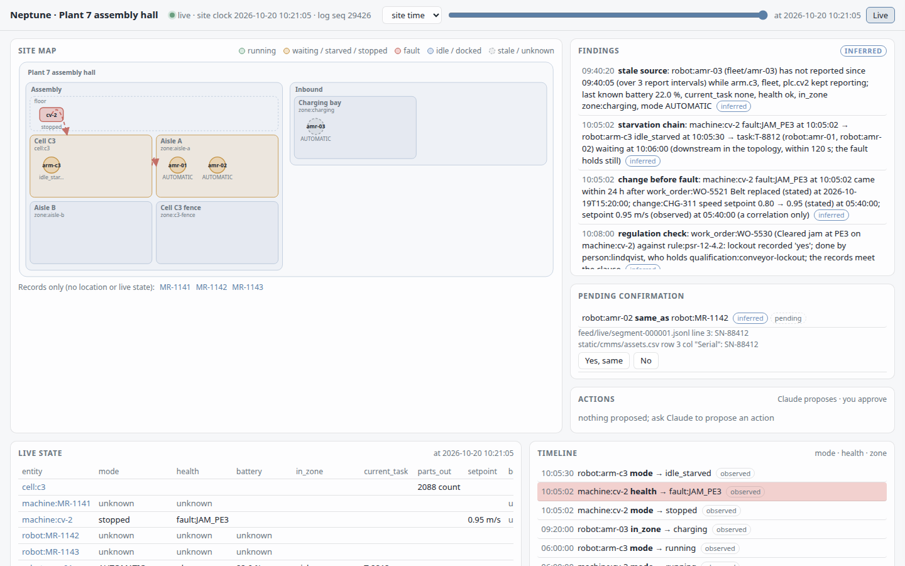
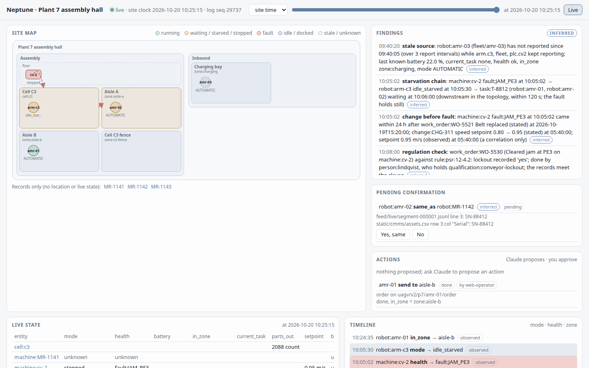

# Neptune

**A live, cited model of a whole robot site that Claude can ask.** Neptune folds a site's exports, documents
and live robot feeds into one fact log: robots, machines, people by role and shift, tasks, rules, and what
feeds what. Every answer cites the file, row, page or feed line it rests on, and says `stale`, `unknown` or
`pending` instead of guessing.

## Run it

Needs `uv` and GNU make 3.82+. `make setup` once, then:

```
make site-show                  # the demo: Plant 7 live at 10x, the web view, and a 3-minute script
make site-show SITE=harbor      # the same for Harbor DC
```

`site-show` prints what to watch on the map, what to click and which questions to ask Claude, plus the
`claude mcp add neptune-site -- ...` line, then starts a local MQTT broker, Neptune subscribed to it, the
site's robot feeds replayed from just before the incident, and the web view at `http://127.0.0.1:8765/`.
Ctrl-C stops everything.



The map is laid out from the site's own declarations (areas, cells, zones, what feeds what) and coloured by
each robot's live mode, health and task. Click any glyph or fact and the cited source opens: the feed line,
spreadsheet row, PDF block or photo region it rests on. Findings are Neptune's inferred, deterministic
rules (starvation chains, qualification gaps, stale sources). Assets only a CMMS export names, with no
location or live state, are listed under the map as "records only".

**The page: see the site, ask it, improve it.** Three minimal panes: the things on the site on the left;
an overview, a graph of every thing and how they link, or one thing's timeline in the centre; and **Ask**
on the right, where Claude answers from the model, shows each query it ran and cites the line it rests
on (click to open it). The overview and Improvements views hold the site's mission (`static/mission.yaml`: goals with a target, and constraints any change must
respect), every evidence source and how fresh it is, coverage of each robot, machine, cell and person by
live feed, records, documents and inferred facts, and what changed since the last run. Paste your own Anthropic API key (it stays in the local server's memory, never on disk) and Claude ranks
improvements against the mission. Each one shows its cited evidence, a ✓ ✗ ? per constraint, a size and
its basis, and what is unknown. When the site changes materially (a new document, a fault, a new finding)
the list re-runs and shows what moved and what retired. Accepting one that carries a robot action sends
it. Each run is recorded, so rebuilding the log never calls a model.

**Actions, approved by a person.** Ask Claude to propose one ("send amr-01 to aisle-b"): it logs an inferred
proposal citing its reasons. It shows in the Actions panel of the classic view (`/classic`); Approve sends the robot's fleet manager a
VDA 5050 `order`, and the panel and the log follow it through intent, dispatched and outcome, each cited. No
MCP tool approves, and actions never touch safety functions.



Other ways in:

```
make site-demo                  # Plant 7 built to the end of its story; prints the MCP line
make site-demo SITE=harbor      # Harbor DC (warehouse: sorter, legged inspector, humanoids, goods-to-person)
make site-demo SITE=public      # real public data: a UR3 cobot's controller export (below)
make site-web                   # the web view over an already-built site
make site-live                  # live at 60x without the script (SPEED=..., SITE=harbor)
make site-sim                   # a simulated Plant 7, live, that obeys approved actions (DAYS, SEED)
claude mcp add neptune-site -- <the "MCP:" line it printed>
```

While a site is live, the MCP server picks up each new log entry before every call;
`neptune_site_changes` lists what arrived since your last answer. Drop a file into `site-demo/static/` and
it is ingested.

**Your own folder:** lay it out as `<dir>/static/` (a `layout.yaml` naming your areas, robots, machines and
feed sources, plus your exports: CSV, XLSX, JSON, JSONL, PDF, photos) and `<dir>/feed/*.jsonl` (recorded feed
messages, one `{t, source, topic, payload}` envelope per line). Then:

```
uv run --all-packages --all-groups python -m neptune_memory.site build <dir>
uv run --all-packages --all-groups python -m neptune_memory.site draft-mapping <dir> static/cmms/work_orders.csv
```

`build` logs every file it cannot map as `not mapped` (still searchable, never a fact). `draft-mapping` drafts
the entry for one file; check it, save it into `<dir>/static/neptune.mappings.yaml`
(a worked example: [`scripts/public_site/neptune.mappings.yaml`](scripts/public_site/neptune.mappings.yaml)) and `build` again. The Claude Code skill does the same loop and shows
you every draft before it saves. No mapper code names a site: Plant 7 and Harbor differ only in that file.

## Your own robot: one prompt

Point an agent at a folder of anything about your robot (controller exports, logs, manuals, notes, photos)
and give it your goal. Add the server once, with an empty folder for the site:

```
claude mcp add neptune-site -- uv run --directory "$PWD" --all-packages python -m neptune_context.mcp --site "$PWD/my-robot"
```

Then paste this into Claude Code, with your folder and goal:

> Set up Neptune on `~/robot-data` with the neptune_setup_* tools. My goal: halve protective stops on the
> arm without slowing its cycles; never change a safety function. Start, then go through the inventory:
> draft and save a mapping for each table, answering what the files answer and asking me only the rest
> (record those with neptune_setup_ask). Write my goal as the mission, build, and show me the status.

`neptune_setup_start` copies the folder in (your files are never touched) and builds: everything is in memory
at once, unmapped files as cited text. The agent then maps each table (`neptune_setup_draft` drafts it and
lists what only you can say: a column it cannot name, a reading with no unit, a table with no time), writes
your goal verbatim and as a mission, and builds again. A question you leave unanswered stays `unknown` in
the memory; it is never filled in. Without an agent: `python -m neptune_memory.site setup start|inventory|draft|mission|build|status`.

## Ask it

What Claude gets back from the `neptune-site` MCP tools (trimmed; real output of `make site-demo`):

**"What did the CV-2 jam hold up?"** (Plant 7, `neptune_site_insights` at 10:10)

```text
- machine:cv-2 finding = "starvation chain: machine:cv-2 fault:JAM_PE3 at 10:05:02 → robot:arm-c3
  idle_starved at 10:05:30 → task:T-8812 (robot:amr-01, robot:amr-02) waiting at 10:06:00 (downstream in
  the topology, within 120 s; the fault holds still)" since 10:05:02 · inferred [S7][S8][S9][S10]...
! findings are inferred by deterministic rules: correlations, not causes
[S7] feed/plc_cv2.jsonl line 3423 "JAM_PE3"
[S9] feed/arm_c3.jsonl line 3428 "no part at pick position for 28 s; waiting for infeed"
[S10] static/layout.yaml line 26 "- {subject: machine:cv-2, predicate: feeds, object: cell:c3}"
```

**"Who can reset the tripped sorter right now?"** (Harbor, `neptune_site_insights` at 10:20)

```text
- machine:sort-1 finding = "qualification gap: machine:sort-1 fault:OVERTEMP_M2 needs
  qualification:electrical-isolation (rule:hsr-7-3.4) and no on-shift holder is free from 10:12:10 to now;
  its only holder, person:reyes, is on break 10:00:00 to 10:30:00" since 10:12:10 · inferred [S11][S1][S5][S12][S13]
[S1] static/docs/HSR-7_excerpt.pdf page 1 block 2 "3.4 After a thermal-overload trip, a powered sorter drive
     is inspected and reset only by a person qualified for electrical isolation."
[S5] static/roster/roster.csv row 2 col "Certifications" "electrical-isolation|sorter-reset"
[S11] feed/sorter_plc.jsonl line 1035 "OVERTEMP_M2"
[S13] static/roster/roster.csv row 6 col "Break from" "10:00:00"
```

**"Is fleet robot gtp-03 the CMMS asset AMR-17?"** (Harbor, `neptune_site_resolve`, before anyone confirms)

```text
- robot:AMR-17 serial = "GTP-4471" · stated [S1]
- robot:AMR-17 same_as = robot:gtp-03 · inferred, pending [S1][S3]
[S1] static/cmms/assets.json json /assets/2/serial "GTP-4471"
[S3] feed/rmf_fleet.jsonl line 3 "GTP-4471"
```

Two names stay two entities until an operator says yes (`python -m neptune_memory.site confirm <dir>`;
`make site-demo` answers yes for the demo). Gold questions pin all of this in CI: Plant 7 8/8 and 3 insight
questions, Harbor 5/5 and 2 insight questions, the public UR3 site 5/5 (nightly), each checked by its cited facts, never by wording.

## What's real, what's synthetic

- **Real data:** `make site-demo SITE=public` fetches UCI's **UR3 CobotOps** export (CC BY 4.0, 1.7 MB,
  sha256-pinned, not committed): 7,409 rows of one Universal Robots UR3's controller log with protective
  stops, grip losses, cycles and joint temperatures. One mapping file turns it into facts, and 5 gold
  questions cite its workbook cells ([real-data.md](docs/site-model/real-data.md)).
- **Synthetic:** both demo sites. Plant 7 and Harbor DC are deterministic generated corpora (`generate --site`):
  invented people, regulations, work orders and two days of feed messages. No real robot or plant is
  connected; actions go to a simulated fleet manager that answers a VDA 5050 order. Feed payloads are JSON in the shape of each dialect (Sparkplug metrics, OPC UA node values,
  VDA 5050 state, Open-RMF fleet states, ROS 2 `DiagnosticArray`), not the binary wire formats.
  The whiteboard photo's text is a recorded model extraction; `extract-photos` re-records it if you set
  `ANTHROPIC_API_KEY` (`uv sync --extra anthropic`).
- **Real:** everything that reads them. The Neptune compiler ingests the files (CSV, XLSX, JSON, PDF, PNG)
  into cited packages; one mapping file per site turns rows, blocks and feed fields into facts; the fact log,
  views, identity proposals, insights and MCP tools are the same code for any site. `site-live` is a real
  MQTT broker (amqtt) and client (paho-mqtt): it records each message, then logs it, and a rebuild from the
  recording gives the same bytes.
- **Not there:** no MQTT auth, TLS or reconnects; no hosted service. Insights are five deterministic rules
  (starvation chains, qualification gaps, stale sources, changes before faults, regulation checks):
  correlations, never causes. A PDF's rules need a hand-written `documents:` entry; `draft-mapping` covers
  CSV and JSONL tables and feeds only. Times are the site's clock, never converted.

## Development

```bash
make setup   # uv-managed venv with dev tools
make check   # lint + mypy --strict + tests (what CI runs); PKG=neptune-memory for one package
```

Working here? Read `AGENTS.md` and [`ARCHITECTURE.md`](ARCHITECTURE.md). Neptune is a demo project. Raw sources are never
rewritten, every value carries provenance, blanks stay blank, and the same inputs give the same bytes.

## License

[Apache License 2.0](LICENSE).
